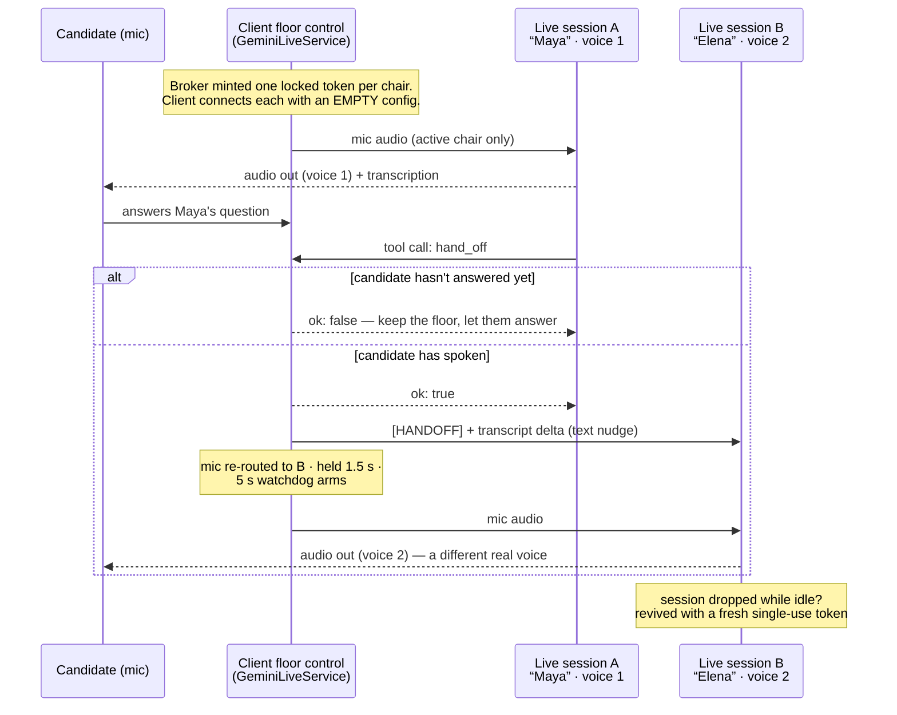
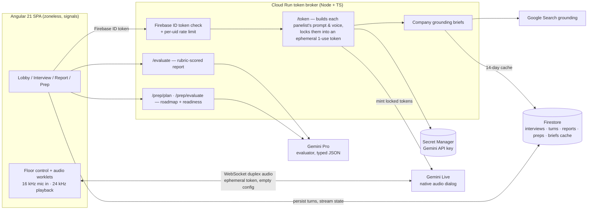

# PanelPrep — a live, multi-voice AI interview panel

**🔴 Live app: [https://panel-prep.web.app](https://panel-prep.web.app)** — sign in with Google and get interviewed right now.

> **Note:** This is a curated showcase of the production codebase, prepared for hackathon judging. Live app: https://panel-prep.web.app

PanelPrep puts you in front of a **panel of two AI interviewers with two distinct real voices**, holding a fully spoken, full-duplex mock interview — they greet you, probe your answers, interrupt-tolerantly hand the floor to each other, and calibrate their questions to the target company, role, and seniority you chose (grounded in how that company *actually* interviews, via Google Search). When you're done, a rubric-anchored evaluator scores the transcript into a structured report, and an optional voice coach debriefs you on it. A **Prep Track** closes the loop: paste a job description, get a generated skill-map roadmap, drill skills in resumable coached voice sessions, watch a readiness score climb to interview-ready, then hand off into a prefilled panel interview.

Everything is Google-stack: **Gemini Live** (native audio dialog) for the panel, coach, and prep sessions; **Gemini Pro** for the evaluator; **Google Search grounding** for company briefs; **Firebase** (Auth, Firestore, Hosting) and **Cloud Run** underneath.

---

## The hard problem: two voices, one conversation

A Gemini Live session is locked to **one** voice. There is no API for "two speakers in one session." PanelPrep gets a genuinely multi-voice panel by running **one Live session per panelist** — each with its own voice and its own single-identity system prompt — and making the **client the floor-control authority**:

- Only the **active** panelist's session receives mic audio. The other session sits idle.
- The model itself signals a handoff by calling a **`hand_off` function tool** (declared server-side, locked into its token). The client acks the call, syncs the conversation delta into the other session as a `[HANDOFF]` text nudge, and re-routes the mic.
- Because a live interview is messy, the handoff path is defended by field-tested guards (diagnosed from real interview transcripts):
  - A `hand_off` is **rejected** (`ok: false`) unless the candidate has spoken since the last handoff — this kills panelist↔panelist ping-pong loops.
  - A **verbal throw** ("Elena, over to you.") without the tool call still moves the floor — a phrase detector runs at turn end.
  - The mic is **held for 1.5 s** after a switch so room noise can't barge-in the new speaker's reply before it starts, and a **5 s watchdog** nudges a silent floor-holder once, then hands the floor back — the room can never go dead.
  - Interrupted turns **flush immediately**, so barge-ins never smear into mislabeled mega-turns in the transcript.
- Live connections cap out (~10 min, with a `GoAway` warning). Idle sessions are simply revived with a fresh single-use token at the next handoff; the **active** session auto-resumes seamlessly — re-mint, reconnect, `[HANDOFF]`-nudge to continue — with the persisted transcript baked into the revived prompt. Transcript is persisted turn-by-turn in Firestore, so nothing is ever lost.



## How it works (system view)



## Security model

Security was treated as a first-class feature, not an afterthought:

- **The Gemini API key never leaves the server.** It lives in Secret Manager and is read only by the Cloud Run broker. The browser never sees it — it receives only ephemeral tokens.
- **Prompts are server-locked.** Each panelist's system prompt, persona, voice, and the `hand_off` tool are built server-side and **baked into the ephemeral token's `liveConnectConstraints`**. The client connects with an *empty* config — it cannot read, override, or jailbreak-edit the prompt. (Verified: prompt strings are absent from the shipped client bundle.)
- **Tokens are single-use and short-lived**, with a narrow new-session start window. A leaked token is worth one already-configured session at most.
- **Every broker endpoint requires a Firebase ID token**, verified server-side with `firebase-admin`, plus a **per-uid rate limit**.
- **Per-user data isolation** in Firestore (`users/{uid}/…`) enforced by security rules, including a recursive guard over subcollections.

## Features

Adapted from the production delivery scorecard:

| Capability | Status | Notes |
| --- | --- | --- |
| Google sign-in + per-user data | ✅ | Firestore rules-enforced isolation |
| Conversational intake (no forms) | ✅ | the panel *asks* — plus optional quick-setup chips |
| Live duplex spoken interview | ✅ | Gemini Live native audio, real barge-in |
| Two interviewers, distinct real voices | ✅ | one Live session per panelist, tool-driven handoffs |
| Personas, turn-taking, active-speaker glow | ✅ | named panel packs (Bar-Raisers, Mentors, Big-Tech Loop) |
| Questions calibrated to company/role/seniority | ✅ | Google-Search-grounded company briefs, cached 14 days |
| Resume / JD upload tailors questions | ✅ | multimodal parse |
| Interview in your language | ✅ | 11 presets + free text; culture-matched panelist names |
| Transcript persistence | ✅ | per-turn to Firestore — survives any disconnect |
| Scored rubric report | ✅ | Gemini Pro, typed JSON output |
| Voice coach debrief on the report | ✅ | opt-in, roadmap-aware |
| Prep Track: JD → roadmap → readiness → interview | ✅ | closed loop with a 0–100 readiness score |
| Seamless session auto-resume | ✅ | Live's ~10-min cap is invisible to the candidate |
| Session history & journeys | ✅ | prep sessions + interviews grouped per plan |

## Tech stack

| Layer | Choice |
| --- | --- |
| Frontend | **Angular 21** — standalone components, **zoneless**, signals; Tailwind CSS v4 |
| Firebase | Modular Web SDK used directly via DI tokens (no wrapper lib): Auth, Firestore, Hosting |
| Backend | **Cloud Run** Node/TypeScript token broker |
| Live audio | **Gemini Live** native audio dialog (one session per voice), AudioWorklet PCM pipeline |
| Evaluation | **Gemini Pro** with typed JSON schemas |
| Grounding | **Google Search grounding** via Gemini, Firestore-cached briefs |
| Secrets | **Secret Manager** — API key is server-only by construction |

## What's in this repo

```
README.md                 ← you are here
docs/ARCHITECTURE.md      ← key design decisions and why
client/core/live/         ← the dual-session floor-control engine + audio pipeline
client/core/data/         ← Prep Track Firestore service (live signal streams)
server/src/               ← broker: locked-token minting, prompts, grounding
```

Each file is real, running production code, excerpted for judging. The full application (UI components, evaluator, prep planner, routing, rules) runs live at **[panel-prep.web.app](https://panel-prep.web.app)**.
